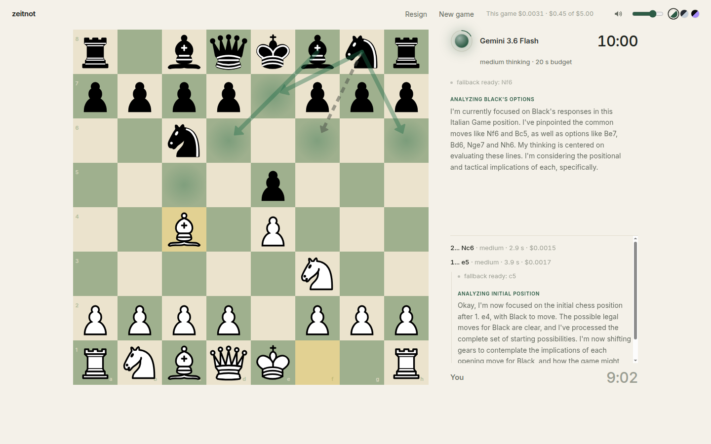
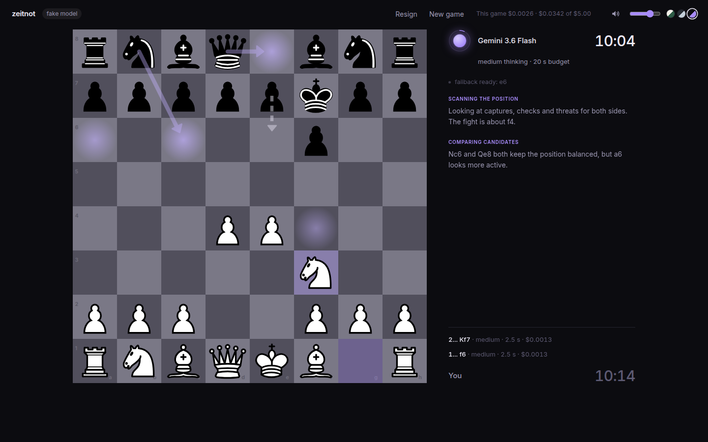

# zeitnot

Play chess against an LLM that decides when to think, and watch it reason while it plays.



zeitnot is a local browser app. You pick a time control and play Gemini Flash. A harness sits between the clock and the model. On every move, the harness decides how long the model may think, and it keeps a cheap backup move ready so the model never loses on time. The model's thinking streams beside the board, and the board shows where it is looking. *Zeitnot* is the chess word for time trouble.

## What you see

- **Gaze.** The model's thinking summaries stream beside the board. Squares the model names glow, and moves it names that are legal get faint arrows, at most three at a time.
- **The harness at work.** An orb breathes while the model thinks. A ring around the orb fills over the move's time budget. A dashed ghost arrow shows the backup move held in case time runs short.
- **The game.** Click or drag moves, with legal-move dots, a check glow, a promotion picker and gliding pieces. Clocks run with increments. Each finished move collapses into a history row, and you can expand the row to reread that move's thinking. The end card shows think time, the thinking levels used, fallbacks and cost.
- **Three themes and recorded sounds.** Paper, Slate and Night. The move, capture and check sounds are recorded CC0 samples with slight variation per play.



## How the harness decides

The browser owns the game and both clocks. For each model move it calls one streaming endpoint, `POST /api/think`, with the move list and the clocks. The server does the following:

1. It plays a forced move at once.
2. It computes a time budget from the clock and picks a thinking level that fits:

   | Time control | Level at the start of the game | Budget | Hard deadline |
   |---|---|---|---|
   | 1+0 | backup move only | 1.5 s | 3 s |
   | 3+2, 5+3 | `low` | 6 to 10 s | 12 to 20 s |
   | 10+5, 15+10 | `medium` | 19 to 30 s | 38 to 61 s |

3. It starts a `minimal` thinking call in parallel, offering only moves that do not leave the moved piece hanging. That call returns the backup move.
4. It streams the main call's thinking to the browser and plays the main answer if it lands before the deadline. Otherwise it plays the backup move. With under 2 s left, it plays a rules-only safe move and makes no API call.

The design is in [docs/app.md](docs/app.md), and the interface design is in [docs/ux.md](docs/ux.md).

## What the experiments found

All numbers come from the [P0 findings](experiments/p0_probe/FINDINGS.md), measured on real Lichess blitz positions graded by Stockfish 19. Loss means win probability given up per move, in percentage points.

- **Speed decides blitz.** OpenAI's gpt-6-luna generates about 80 reasoning tokens per second. A move took 11 s at `low` effort and 95 s at `high`, so only its no-reasoning mode fits blitz. Gemini 3.6 Flash takes 1.4 s at `minimal`, 4.2 s at `low` and 12.1 s at `medium`.
- **A one-move safety filter halves the fast mode's damage.** Offering Luna only moves that do not hang the moved piece cut its no-reasoning loss from 21.1 to 10.0 points per move, at the same 1.3 s. The 95% interval for the improvement is 7.7 to 14.6 points. On a 30-position subset the filtered fast mode matched `medium` effort, which takes 20 times as long.
- **The model's own confidence is a weak signal.** OpenAI's Decisions API played no better than random moves, and its "how sharp is this position" score did not predict real sharpness (AUC 0.55). A rules check on the chosen move predicted mistakes best (AUC 0.76).
- **A real 10+5 game never flagged.** Gemini played 53 moves with a median of 13.5 s each and finished with 49 s on its clock, for $0.44. It lost to Stockfish limited to 1500 Elo, after three mistakes in a row during its own attack. Each of those moves got 10 to 13 s while nearly 10 minutes remained. That points at the next feature: re-check sharp moves at a higher thinking level.

The prior-art survey behind the project is in [docs/research.md](docs/research.md).

## Run

Requires Python 3.12 and [uv](https://docs.astral.sh/uv/).

```bash
uv venv --python 3.12
uv pip install -e . --group dev
cp .env.example .env    # then add your GEMINI_API_KEY
.venv/bin/python -m zeitnot
```

This serves http://127.0.0.1:8000 and opens a browser tab. A game at 10+5 costs about $0.28 to $0.47 on Gemini Flash at introductory prices. `ZEITNOT_SPEND_CAP_USD` caps total spend (default 5.00). The server tracks spend in `data/spend.json`, and it logs every move in `logs/moves.jsonl`. The Gemini free tier failed most calls in testing, so the app needs a key with billing enabled.

Fake mode needs no key and makes no API calls. It streams scripted thoughts that name real moves, so the gaze effects show:

```bash
ZEITNOT_FAKE_MODEL=1 .venv/bin/python -m zeitnot
```

Options are `--port N` or `ZEITNOT_PORT`, and `--no-browser` or `ZEITNOT_NO_BROWSER=1`.

## Test

```bash
.venv/bin/python -m pytest -q
```

No test calls a paid API. The tests include the browser's pure modules (`web/gaze.js`, `web/util.js`), which pytest runs with `node --test` when node is installed.

## Layout

| Path | Contents |
|---|---|
| `zeitnot/` | The server: time manager, model clients, per-move orchestration, spend ledger |
| `web/` | The browser app: board, mind panel, gaze, sounds, themes |
| `tests/` | Python tests and the node tests for the browser's pure modules |
| `docs/` | Research survey, research design, app design, UX design |
| `experiments/p0_probe/` | Throwaway measurement scripts and their raw results |
| `experiments/app_smoke/` | A real-game smoke test through the app's API, with its game record |

The experiment scripts also use Stockfish and the January 2013 Lichess database. Neither is in the repo. Download them into `tools/stockfish/` and `data/raw/lichess/` to rerun the scripts.

## Third-party assets

The page loads its libraries from cdn.jsdelivr.net at pinned versions and its font from Google Fonts, so it needs network access.

| Asset | Source | Licence |
|---|---|---|
| cm-chessboard 8.15.4, the board and its Markers, Arrows and PromotionDialog extensions | Stefan Haack, [github.com/shaack/cm-chessboard](https://github.com/shaack/cm-chessboard) | MIT |
| Piece sprite `assets/pieces/standard.svg` | Wikimedia Commons standard pieces by Cburnett and Rfc1394, modified by Stefan Haack for cm-chessboard | [CC BY-SA 3.0](https://creativecommons.org/licenses/by-sa/3.0/) |
| Marker sprite `assets/extensions/markers/markers.svg` | Stefan Haack | [CC BY-SA 3.0](https://creativecommons.org/licenses/by-sa/3.0/) |
| Arrow sprite `assets/extensions/arrows/arrows.svg` | Ships in the cm-chessboard package with no separate notice | MIT, the package licence |
| chess.js 1.4.0 | Jeff Hlywa, [github.com/jhlywa/chess.js](https://github.com/jhlywa/chess.js) | BSD-2-Clause |
| Inter font | Rasmus Andersson, served by Google Fonts | SIL Open Font License 1.1 |
| Sounds in `web/sounds/` | Kenney, derived from two CC0 packs; details in [web/sounds/LICENSE.md](web/sounds/LICENSE.md) | CC0 |

The start screen credits the piece and marker artists, as CC BY-SA requires.

## License

The code is under the [MIT License](LICENSE). The third-party assets above keep their own licences.
