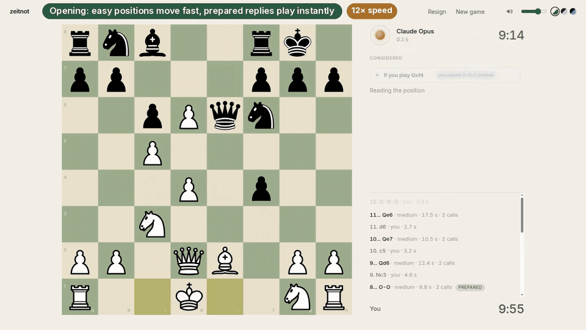
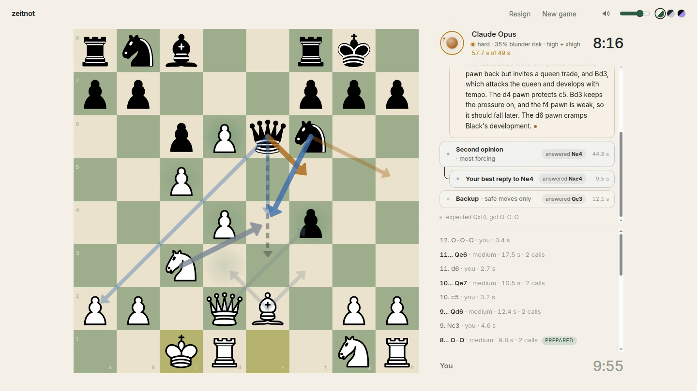

# zeitnot

Play chess against an LLM that decides when to think, and watch it reason while it plays.



**[Watch the one-minute demo (MP4)](docs/media/zeitnot-demo.mp4)**: a real 10+5 game against Claude Opus, from the opening to a hard middlegame where an `xhigh` second opinion disagrees with the main call.

zeitnot is a local browser app. You pick a time control and play Claude Opus or Codex Sol through the command-line tools you are already logged in to. A harness sits between the clock and the model. On every move, it decides how hard the position is, how long the model may think, and whether to ask for a second opinion. The model's commentary streams beside the board, and the board shows where it is looking. *Zeitnot* is the chess word for time trouble.

Every move the model plays is a move the model chose. Code never picks or overrides a move, with one exception: a position with a single legal move. No chess engine runs during a game. If the model has no answer when its clock runs out, it loses on time.

**What makes it different:**

- **A model of human play decides how hard each position is.** [Maia-2](https://github.com/CSSLab/maia2) rates the chance that an 1800 blitz player blunders. Openings come out easy and sharp middlegames hard. In a real game, Opus lost 9.9 points of win% per move on positions Maia rated hard, against 2.6 on easy ones.
- **The clock buys reasoning effort.** Each move gets a share of the clock, scaled by difficulty and budgeted by the model's expected think time. A slower clock buys a deeper level, up to Claude's `xhigh`.
- **Hard moves get a second opinion that thinks deeper.** It runs in parallel, one effort level above the main call. When the two disagree, the harness compares them: either the opponent's best reply to each move, or a single quick pick when time is short.
- **It thinks on your time.** While you think, it prepares answers to the replies it expects. It plays about half its moves instantly, and it budgets the clock for that.
- **Everything is visible.** Every model call is a card, the difficulty and effort show under the model's name, and a post-game script grades each move with Stockfish beside what the harness decided.

## Opponents

The server looks for two command-line tools when it starts, and again at most every 30 s while the start screen asks:

| Opponent | Offered when | Starts at | Speed, measured |
|---|---|---|---|
| Claude Opus | `claude` is installed and `claude auth status` reports logged in | 5+3 | about 8 s a move at low effort, 15 to 20 s at high; `xhigh` is typically 20 s with slow cases near two minutes |
| Codex Sol (`gpt-6.1-sol`) | `codex` is installed and `codex login status` reports logged in | 15+10 | about 5 to 60 s a move |

The start screen shows only the opponents it found, as plain text, and remembers your last choice. Otherwise it picks Claude Opus, then Codex Sol. Log in while the app is running, and the opponent appears within a minute. If it finds neither, it says how to install and log in to each, and offers a free fake demo.

There is no model choice. Claude always runs Opus and Codex always runs Sol, for every call: the main call, the second opinion, the backup, the reply and pick calls, and pondering. Opus uses more of a Claude plan's usage limit than the smaller Claude models do.

Each Claude call is one `claude -p` process stripped of Claude Code's agent context: no tools, no settings, no MCP servers, no slash commands, no saved session, the app's own system prompt, and the legal moves as an enum in `--json-schema`. It runs from an empty directory the app owns, so no project files are read. The app removes `ANTHROPIC_API_KEY` from the process's environment, so the call uses your subscription login, not a billed key. Codex runs one `codex app-server` per server process, with a fresh thread per call and its injected context turned off.

### Your Claude subscription and Anthropic's terms

Using your Claude subscription through this app is meant for your own personal games, under Anthropic's terms. Anthropic does not let third-party products offer claude.ai login without its approval. If you distribute this app, run Claude with an API key instead: set `ANTHROPIC_API_KEY` and `ZEITNOT_CLAUDE_BARE=1`, and each call runs `claude --bare`, which reads only the key. API calls are billed per token.

### Gemini

Gemini Flash is still available as a paid opponent. Set `ZEITNOT_GEMINI=1` and a `GEMINI_API_KEY` with billing enabled. `ZEITNOT_SPEND_CAP_USD` caps total spend (default 5.00), and the server tracks spend in `data/spend.json`.

## What you see

- **How hard it finds the position.** Under the model's name, one line reads, for example, "hard · 34% blunder risk · high": Maia-2's difficulty, the chance an 1800 blitz player blunders here, and the effort the clock bought. The dot turns amber on hard positions.
- **Every model call is a card.** The mind panel shows the plan line (the difficulty, the level and the budget), then one card per model call as it starts: the main call, the second opinion, the backup, "Your best reply to Bc4", the pick. Replies hang under the call they test, joined by a thin connector. Each card shows its role, the engine and level, a status (thinking, answered Nf3, chosen, cancelled), a live timer, and its own small pulse ring. Finished cards fold to one line while others still think.
- **Commentary and gaze.** Each answer is JSON with a commentary of up to 60 words, the move, the reply it expects, and a note of up to 40 words. The commentary streams into its card as the model writes it. Squares it names glow on the board, and legal moves it names get faint arrows in that card's colour. Each card's answer is an arrow in its colour, and a reply card draws your reply in the opponent's colour. Hovering or focusing a card lights its arrows and dims the rest.
- **The decision.** When the move is decided, the winning card glows in the opponent's accent, the others step back, and one sentence says why, for example "Opinions split (Bc4 vs Nf3). After Bc4 you would play Qb3, so Nf3."
- **The orb.** A ring of points sits inside the orb. Each heartbeat from the server lights the next point, so the arc turns only as fast as the model is really working. Heartbeats come from Claude's hidden thinking, Codex's reasoning and token updates, and each piece of commentary. Each opponent has its own accent colour. A thin ring around the orb fills over the move's time budget, turns amber past it, and red near the deadline. A counter beside it reads, for example, "4.2 s of 9.9 s". The plan line shimmers while the model thinks. When the move lands, the points flare once around the ring and go out. With reduced motion turned on, the points stay still and nothing shimmers.
- **The harness at work.** A dashed ghost arrow shows the backup move, which plays only if the main call misses the deadline.
- **Considering your replies.** While you think, the panel shows the reply the model expects and a card for each reply it is preparing for: "If you play Nf3 · preparing…", then "prepared Bc5". Each has an arrow from your side of the board. When you move, the matching card flashes and its answer plays at once. The others fold with "you played Bc4 instead".
- **The game.** Click or drag moves, with legal-move dots, a check glow, a promotion picker and gliding pieces. Clocks run with increments. The history lists both sides' moves with the time each took: the model's rows show the level, the calls and a "hard" or "prepared" tag, and expand to replay the call tree and decision. The end card shows both sides' think time, how many of the model's moves were hard, the levels used and how many prepared moves played at once. The UI shows no prices.
- **Three themes and recorded sounds.** Paper, Slate and Night. The move, capture and check sounds are recorded CC0 samples with slight variation per play.



## How the harness decides

The browser owns the game and both clocks. For each model move it calls one streaming endpoint, `POST /api/think`, with the move list and the clocks. The server does the following:

1. It plays a forced move at once.
2. It builds one compact prompt from the board: the game, the clocks, the moves in SAN, the FEN and a piece list, rules facts (checks, captures, your attacked pieces, what the opponent's last move attacks, mate in one), your note from the last move, and the allowed moves. The allowed moves carry no "hangs piece" tags: that rule marked the knight sacrifices Opus missed as blunders.
3. It rates how hard the position is with [Maia-2](https://github.com/CSSLab/maia2), a network trained on human games, as the chance that an 1800 blitz player blunders here. Below 1% the move is easy; at 10% or above it is hard. Maia-2 never trained on the first 10 plies of a game, so there, and when the optional `maia` extra is not installed, the count of legal moves stands in. The rating sets only the time; the model never sees it. On 60 graded positions it separated Opus's blunders with AUC 0.73, against 0.47 for the rules flag it replaces ([findings](experiments/maia_check/FINDINGS.md)). In a real 3+2 game it scored 0.71, and Opus lost 9.9 points per move on positions it rated hard against 2.6 on easy ones.
4. It computes a time budget. Pondering makes many moves instant (21 of 38 in that game), so the clock is shared among the moves expected to cost time, using the game's own ponder hit rate (starting at 30%, capped at 50%). An easy move gets 0.6 of a share and a hard one two shares. The level is the deepest one whose expected latency (the average of its recent calls) fits the budget and whose 90th-percentile latency fits the deadline of twice the budget, because public leaderboards show more reasoning effort plays better. Budgeting by the median let half the moves overshoot: in a 5+3 game, normal moves at `high` took 25 to 35 s against 14 to 25 s budgets, and Opus ran out of time. On hard moves, "high + xhigh" means the second opinion thinks one level deeper (step 6). A slower clock buys a deeper level, and the start screen says what each clock buys. The live latency table updates after every call. At move 10, with the starting ponder rate:

   | Time control | Opus, easy | Opus, normal | Opus, hard | Sol, easy | Sol, normal | Sol, hard |
   |---|---|---|---|---|---|---|
   | 1+0 | low, 1.7 s | low, 2.9 s | low, 5.7 s | low, 1.7 s | low, 2.9 s | low, 5.7 s |
   | 3+2 | low, 6.1 s | low, 10 s | medium + high, 20 s | low, 6.1 s | low, 10 s | low, 20 s |
   | 5+3 | low, 10 s | low, 17 s | high + xhigh, 33 s | low, 10 s | low, 17 s | low + medium, 33 s |
   | 10+5 | medium, 20 s | high, 33 s | high + xhigh, 65 s | low, 20 s | low, 33 s | medium, 65 s |
   | 15+10 | high, 31 s | high, 51 s | xhigh, 102 s | low, 31 s | low, 51 s | medium, 102 s |

5. When the main call thinks above low, a backup call runs in parallel at low, offered only safe moves. It plays only if the main call misses the deadline.
6. On a hard move, a second opinion runs in parallel, asked for the most forcing good move. It thinks one level deeper than the main call when that level's median latency fits the budget, and the harness waits for it only until the budget runs out, so the main answer covers its slow cases. That is how Opus's `xhigh`, whose slow case (117 s) is too long for a main call before 15+10, reaches hard moves from 5+3 on. If both answer the same move, it plays. If they split, the pair is compared, as deeply as the deadline allows:
   - **Full comparison** (two rounds of low calls fit): a reply call plays your strongest reply to each candidate, the server lists material, threats and checks after each reply, and one pick call chooses.
   - **Quick comparison** (one round fits): the server lists your checks and captures after each candidate, and one pick call chooses.
   - **No time**: the main answer plays.

   The pick sees the candidates as other players' suggestions. Code never scores a line. Set `ZEITNOT_OPINIONS=0` to turn the second opinion off.
7. The model's answer plays as it is. No rule overrides it, and only the deadline can replace it with the backup's move. Otherwise the server keeps waiting, and the model can lose on time.
8. The note and the expected reply are kept. The expected reply is SAN that the server checks against the position after the move. On the next move, the prompt either keeps the note (you played the expected reply) or gets a digest of at most 60 words built by code: "Prepared for a different reply; re-check.", what was expected and played, the prepared moves that are still legal, and the pieces still under attack. The facts block stays the authority.

While you think, the server ponders the position after the reply the model expects, and if you play it, the prepared answer plays at once. Pondering spends your time, not the model's, so a ponder run gets more than a normal move:
- **A longer budget.** It may plan for 60% of your median think time this game, though never past what the model's own clock could cover if you moved at once.
- **A second opinion.** On a hard position it runs the second opinion and the comparison, so the prepared answer has been checked before it plays.

Pondering is on for Claude and Codex. Set `ZEITNOT_PONDER_REPLIES=2` to also ponder a second reply that a second opinion or a reply call gave you. Set `ZEITNOT_PONDER_OPINIONS=0` to drop the second opinion from ponder runs, and `ZEITNOT_PONDER_CLAUDE=0` to turn Claude pondering off.

The design is in [docs/app.md](docs/app.md) and [docs/harness.md](docs/harness.md), and the interface design is in [docs/ux.md](docs/ux.md).

## What the experiments found

All numbers come from the [P0 findings](experiments/p0_probe/FINDINGS.md), measured on real Lichess blitz positions graded by Stockfish 19. Loss means win probability given up per move, in percentage points.

- **Speed decides blitz.** OpenAI's gpt-6-luna generates about 80 reasoning tokens per second. A move took 11 s at `low` effort and 95 s at `high`, so only its no-reasoning mode fits blitz. Gemini 3.6 Flash takes 1.4 s at `minimal`, 4.2 s at `low` and 12.1 s at `medium`.
- **A one-move safety filter halves the fast mode's damage.** Offering Luna only moves that do not hang the moved piece cut its no-reasoning loss from 21.1 to 10.0 points per move, at the same 1.3 s. The 95% interval for the improvement is 7.7 to 14.6 points. On a 30-position subset the filtered fast mode matched `medium` effort, which takes 20 times as long.
- **The model's own confidence is a weak signal.** OpenAI's Decisions API played no better than random moves, and its "how sharp is this position" score did not predict real sharpness (AUC 0.55). A rules check on the chosen move predicted these weaker models' mistakes best (AUC 0.76); for Opus it scored 0.47, which is why the final harness drops it.
- **A real 10+5 game never flagged.** Gemini played 53 moves with a median of 13.5 s each and finished with 49 s on its clock, for $0.44. It lost to Stockfish limited to 1500 Elo, after three mistakes in a row during its own attack. Each of those moves got 10 to 13 s while nearly 10 minutes remained. That points at the next feature: re-check sharp moves at a higher thinking level.

- **A Claude call is mostly the model.** A stripped `claude -p` call with the legal-move enum took 2.9 to 3.1 s with Sonnet at low effort, and the process started in about 0.4 s. A warm spare process saved about 0.4 s a call, but it needs a general schema and a retry for illegal moves, so each call starts a fresh process ([experiments/claude_startup](experiments/claude_startup/probe.py)). Opus took 4.6 s at low, 5.7 s at medium and 6.8 s at high effort, one call each.
- **Claude's safeguards can stop a commentary.** One of four early Sonnet calls, which asked for the model's "thoughts", was refused as `reasoning_extraction`. The field is now a commentary for the people watching, and a refused call is asked once more without it.

The prior-art survey behind the project is in [docs/research.md](docs/research.md).

## Run

Requires Python 3.12 and [uv](https://docs.astral.sh/uv/).

```bash
uv sync --extra maia    # leave out --extra maia to skip Maia-2 and CPU-only PyTorch (about 900 MB)
claude auth login       # or: codex login
.venv/bin/python -m zeitnot
```

The first game downloads the 280 MB Maia-2 blitz model into `~/.cache/zeitnot/maia2`. Set `ZEITNOT_MAIA=0` to rate positions by the count of legal moves instead.

This serves http://127.0.0.1:8000 and opens a browser tab. Claude and Codex cost no money per call, but each move draws on your plan's usage limits. The server logs every move in `logs/moves.jsonl`.

After a game, grade it with Stockfish (download it into `tools/stockfish/` first):

```bash
.venv/bin/python experiments/game_review/review.py            # the last game; --game -2 for the one before
```

It prints each side's average loss, the big swings with the harness's plan for each of the model's moves, and how well Maia's difficulty predicted the model's errors.

Fake mode needs no login and makes no calls. It streams scripted commentary that names real moves, so the gaze and comparison effects show:

```bash
ZEITNOT_FAKE_MODEL=1 .venv/bin/python -m zeitnot
```

Options are `--port N` or `ZEITNOT_PORT`, and `--no-browser` or `ZEITNOT_NO_BROWSER=1`. `ZEITNOT_FAKE_DELAY_SCALE=6` slows the fake engine six times, which makes the call tree easy to watch.

## Test

```bash
.venv/bin/python -m pytest -q
```

No test calls a model. Fake `claude` and `codex` programs stand in for the real ones. The tests include the browser's pure modules (`web/gaze.js`, `web/util.js`, `web/calltree.js`), which pytest runs with `node --test` when node is installed.

## Layout

| Path | Contents |
|---|---|
| `zeitnot/` | The server: engines (`claude.py`, `codex.py`, `engines.py`), facts and prompt, Maia-2 difficulty, time manager, per-move pipeline, comparison, pondering |
| `web/` | The browser app: board, mind panel, gaze, sounds, themes |
| `tests/` | Python tests and the node tests for the browser's pure modules |
| `docs/` | Research survey, research design, app design, UX design |
| `experiments/p0_probe/` | Throwaway measurement scripts and their raw results |
| `experiments/app_smoke/` | A real-game smoke test through the app's API, with its game record |
| `experiments/harness_eval/` | v1 against v2, verify and the second opinion on the same positions, graded by Stockfish, resumable |
| `experiments/maia_check/` | Whether Maia-2's difficulty predicts Opus's blunders, and the tier cut points |
| `experiments/game_review/` | `review.py` grades a played game from `logs/moves.jsonl` with Stockfish, beside each move's difficulty and level |
| `experiments/claude_startup/` | The Claude start-up measurement: a fresh process per call against a warm spare |

The experiment scripts also use Stockfish and the January 2013 Lichess database. Neither is in the repo. Download them into `tools/stockfish/` and `data/raw/lichess/` to rerun the scripts.

## Third-party assets

The page loads its libraries from cdn.jsdelivr.net at pinned versions and its font from Google Fonts, so it needs network access.

| Asset | Source | Licence |
|---|---|---|
| cm-chessboard 8.15.4, the board and its Markers, Arrows and PromotionDialog extensions | Stefan Haack, [github.com/shaack/cm-chessboard](https://github.com/shaack/cm-chessboard) | MIT |
| Piece sprite `assets/pieces/standard.svg` | Wikimedia Commons standard pieces by Cburnett and Rfc1394, modified by Stefan Haack for cm-chessboard | [CC BY-SA 3.0](https://creativecommons.org/licenses/by-sa/3.0/) |
| Marker sprite `assets/extensions/markers/markers.svg` | Stefan Haack | [CC BY-SA 3.0](https://creativecommons.org/licenses/by-sa/3.0/) |
| Arrow sprite `assets/extensions/arrows/arrows.svg` | Ships in the cm-chessboard package with no separate notice | MIT, the package licence |
| chess.js 1.4.0 | Jeff Hlywa, [github.com/jhlywa/chess.js](https://github.com/jhlywa/chess.js) | BSD-2-Clause |
| Inter font | Rasmus Andersson, served by Google Fonts | SIL Open Font License 1.1 |
| Sounds in `web/sounds/` | Kenney, derived from two CC0 packs; details in [web/sounds/LICENSE.md](web/sounds/LICENSE.md) | CC0 |
| Maia-2 (optional `maia` extra), its code and the blitz model it downloads at first use | CSSLab, [github.com/CSSLab/maia2](https://github.com/CSSLab/maia2) | MIT |

The start screen credits the piece and marker artists, as CC BY-SA requires.

## License

The code is under the [MIT License](LICENSE). The third-party assets above keep their own licences.
