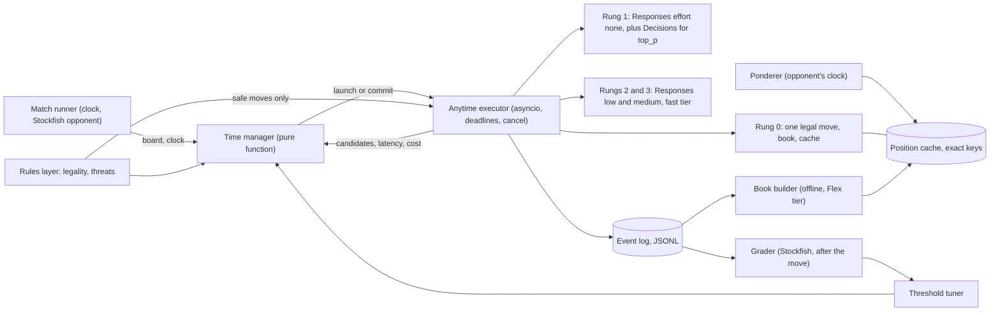

# Design: a clock-aware LLM chess player

This is the original research plan, kept for the record. The app the repo ships is designed in [app.md](app.md) and [ux.md](ux.md). After the P0 probe, the project moved from OpenAI's Luna to Gemini Flash and from engine matches to a play-against-the-model app.

Working name `zeitnot`, the chess term for time trouble. Proposal dated 2026-11-06, scoped as a proof of concept with a total API budget of $10 to $20 on one model, OpenAI's `gpt-6-luna`. The prior art behind each decision is in [research.md](research.md).

## Goal

Make the cheapest OpenAI model play noticeably stronger blitz chess through harness engineering alone. The harness may not fine-tune a model or let an engine choose moves. Move by move, the harness decides how much clock time and money to spend.

The project ships three things:

- A Python player that plays real clocked games against Stockfish, and later on Lichess.
- A replay viewer that shows, for each move, how long the agent thought and why.
- A short report with results and the total API bill.

## Thesis

A 3+2 blitz game gives about 6.5 seconds per move over 40 moves. The P0 probe ([findings](../experiments/p0_probe/FINDINGS.md)) measured Luna at 1.4 s per move with effort `none`, 11 s at `low`, 28 s at `medium` and 95 s at `high`, with move quality rising at each step. A one-move rules filter brings the fast answer close to `medium` quality. Most positions don't need the slow answer. Engines learned decades ago to spend time where the best move is unstable. We port those rules to LLM signals and test whether a harness can turn extra seconds into better moves, which [On the Clock](https://neurips.cc/virtual/2026/170689) found agents fail to do on their own.

## Changes to the original ideas

| Original idea | What the research says | What we build |
|---|---|---|
| Adaptive reasoning and model routing | Both choose how much compute one move gets. With one model, routing becomes a choice of endpoint and effort level. | One compute ladder over Luna's Decisions endpoint and effort levels, and one time manager that climbs it. |
| A decision model decides whether to think longer | A general model reading FEN is weak at judging whether a position is critical. P0 confirmed it. The Decisions sharpness score had no relation to real criticality (AUC 0.55). As a move picker, Decisions played no better than effort `none`. | Decisions is the emergency rung at 0.2 s, the opponent-move predictor for pondering, and a secondary escalation signal through its top-move probability (AUC 0.67). Escalation is local code built on a one-move rules check, which predicts mistakes best (AUC 0.76). |
| Think ahead on the opponent's time | Published for LLM chess (Speculative Actions, 2025), with no clock and no game results. It gains nothing against an opponent that moves instantly. | Ponder with Decisions calls, which cost about $0.0001 each. Test it against an opponent that takes human-like time. |
| Memory and caching | Exact positions rarely repeat after the opening. A similar-looking position can need the opposite move. | Exact-key cache only. Its value comes from ponder results, the predicted line, and a self-prepared opening book. |
| Self-improvement | Reflective prompt memory gave small or negative gains in competitive games. | The harness tunes its own escalation thresholds on logged games and grows its opening book. Both are cheap and measurable. |
| No Stockfish | Stockfish is still the only practical grader and opponent. | Stockfish plays as the opponent and grades positions after the fact. It never runs inside the agent's move decision. |

## Purity contract

The decision loop is everything that runs between "position received" and "move sent".

| Allowed in the decision loop | Never in the decision loop | Allowed outside the loop |
|---|---|---|
| Game rules from python-chess: legal moves, check, captures, attack maps, and the one-move safety filter built on them | Any engine, evaluation function, or search beyond one ply of rules | Stockfish as the opponent |
| Luna calls through Responses and Decisions | External opening books and tablebases | Stockfish grading of positions and finished games |
| The agent's own cache and self-prepared book | Neural chess models | Tuning thresholds on graded logs |

The attack-map features and the safety filter are rules-level facts, not search. The filter removes moves that leave the moved piece attacked and undefended, or attacked by a cheaper piece, unless the move captured something at least as valuable. It is still hand-written chess knowledge, so the report shows every result with and without it.

## Architecture



The design separates a pure core from an asynchronous shell. The time manager is a pure function from search state to actions. The executor owns all API calls and timing. A recorded game or a cached set of answers therefore replays through a new time manager with a fake clock, at no API cost. That replay is how the time manager gets tuned.

The player is a Python class that the match runner calls directly. A UCI adapter for Lichess and chess GUIs comes last, because the experiments don't need it.

### Core data shapes

```python
class Clock:          # milliseconds
    mine: int; theirs: int; increment: int

class Rung:           # configuration data, not code
    id: str
    endpoint: Literal["decisions", "responses"]
    effort: Literal["none", "low", "medium", "high", "xhigh", "max"] | None
    latency_ms: LatencyStats             # measured p50 and p90, updated live
    usd_per_call: float                  # measured mean

class Candidate:
    move: Move; rung: str; confidence: float | None
    latency_ms: int; usd: float; line: list[Move]   # predicted continuation

class Signals:
    legal_count: int; safe_count: int; in_check: bool; captures: int
    en_prise_up: bool       # rung 1's move raised the number of my pieces under attack
    ply: int; top_p: float; margin: float
    overturned: bool        # a higher rung disagreed with a lower one
    ms_per_move_left: float; clock_advantage: float
    ponder_hit: bool; book_hit: bool

class SearchState:
    board: Board; clock: Clock; elapsed_ms: int
    launched: set[str]; results: list[Candidate]; best: Candidate | None

Action = Commit(Candidate) | Launch(rung_id) | Wait(until_ms)

def decide(state: SearchState, signals: Signals, ladder: list[Rung], params) -> list[Action]

class MoveRecord: ...   # one JSONL line per move: state, signals, every launch, every result, choice, cost
```

`MoveRecord` is the unit of the whole project. Tuning, metrics, the spend report and the replay viewer all read it.

### Compute ladder

Latency and cost were measured in P0. Every Luna rung chooses only among moves that pass the safety filter.

| Rung | Call | Cost per call | Median latency | Mean loss in P0 |
|---|---|---|---|---|
| 0 | One legal move, book hit, confident ponder hit | $0 | about 0 | |
| Emergency | Decisions API, most probable safe move | $0.00007 | 0.2 s | 11.4 |
| 1 | Responses, effort `none` | $0.00007 | 1.3 s | 10.0 |
| 2 | Responses, effort `low`, fast tier | about $0.0009 | 6.3 s | 12.5 unfiltered |
| 3 | Responses, effort `medium`, fast tier | about $0.003 | 13.6 s | 7.6 unfiltered |
| Offline | Responses, effort `high` | $0.0047 | 95 s | 4.5 unfiltered |

Effort `high` is too slow for any blitz move. It prepares the opening book and can run while pondering at slower time controls. P2 measures rungs 2 and 3 with the filter applied.

### Time manager

Version 1 is a port of Stockfish's time manager.

1. Compute an optimum and a maximum time for this move from the time left, the increment, the ply and the clock advantage.
2. Commit at once on a single legal move, a book hit, or a ponder hit whose confidence is above a threshold.
3. Run rung 1, and the Decisions call alongside it for `top_p`. Read the rules signals: captures available, legal-move count, and whether rung 1's move raised the number of my pieces under attack.
4. Escalate to the cheapest rung whose expected gain exceeds `price_of_time(clock) * p90_latency(rung)`. The expected gain is a hand-written function of those signals and `1 - top_p`, with a few tunable weights. P2 measures which signals still predict mistakes once the safety filter has removed the obvious ones.
5. Apply engine-style multipliers to the budget. Spend more time when a higher rung overturns a lower one (best-move instability), and less when one move dominates.
6. Commit the best result at the deadline. The deadline never exceeds the maximum minus a safety margin for network overhead.

`price_of_time` rises as the time left per expected move falls, so the agent spends freely early and saves itself in time trouble. Below a panic threshold only rungs 0 and 1 run.

### Anytime executor

The executor always holds a legal move. It starts rung 1 at once and replaces `best` whenever a higher rung returns. When escalation looks likely, it launches the next rung together with rung 1 instead of after it, so the agent doesn't pay the latency twice. Each call gets its own deadline. On commit, the executor cancels outstanding calls. Tokens generated before a cancel may still be billed, and the event log records the cost of every call.

### Ponderer

On the opponent's turn, one Decisions call over the opponent's legal moves gives a probability for each reply. The ponderer takes the smallest set of replies that covers a target probability mass, capped at k. For each reply it runs our rung 1, and optionally rung 2, and stores the result in the position cache. A per-game cap bounds the spend.

### Memory

- **Position cache.** Keyed by Zobrist hash, valid within a game. It holds ponder results and Responses answers.
- **Predicted line.** Responses calls return their expected continuation. If the opponent plays the predicted reply, the next move in the line becomes a candidate.
- **Self-prepared opening book.** Between games, the book builder runs Luna at `high` or `xhigh` on the Flex tier (half price) over the opening positions the agent has reached. It expands the tree with rung 1's prediction of the opponent's replies. In play, those positions cost no clock time. Entries come only from the agent's own analysis.

### Self-improvement

1. Every game appends `MoveRecord` lines.
2. Stockfish grades each candidate as a loss in win probability.
3. A grid search replays the logs through the time manager and picks the thresholds and weights that minimise loss per move within the clock. Replay needs no API calls, because every answer and latency is in the log.
4. The tuned parameters play the next batch of games. The learning curve across batches goes in the report.

## Evaluation

The budget allows dozens of games, not hundreds. The main metric is therefore position-level, where each position is its own measurement and noise is much lower.

**Position set.** About 400 positions sampled from real games. Every rung runs on every position once. Stockfish grades every answer as a loss in win probability. Any time-manager variant can then be scored offline, for free, by replaying the cached answers under a simulated clock. The oracle allocation, the best possible choice of rung per position within the clock, shows how much room adaptive allocation has.

**Games.** Small matches against Stockfish at low `Skill Level` values or `UCI_Elo` 1320, at the time control that P0 shows is playable. About 20 to 30 games per configuration. The report gives scores with their intervals, without strong Elo claims.

**Opponent that uses time.** A Stockfish wrapper that waits a human-like think time before it moves. Pondering is tested only against this opponent.

**Configurations.**

| ID | Configuration |
|---|---|
| B1 | Rung 1 every move |
| B2 | One fixed effort every move |
| B3 | Fixed effort with a per-move deadline and rung 1 fallback |
| Z1 | Time manager v1 |
| Z2 | Z1 plus pondering and book |

**Metrics.** Win-probability loss per move, game score, time-forfeit rate, illegal-move rate, seconds per move, dollars per game, ponder hit rate and book hit rate.

## Budget

These are estimates for a $15 plan. P0 cost about $0.37. A hard cap in config stops any run that would exceed its share.

| Phase | Work | Estimated spend |
|---|---|---|
| P0 | Decisions on 200 positions, every effort level on 30 positions with timing | under $1 |
| P2 | Every rung on about 400 positions, Flex tier where latency is not needed | $1 to $2 |
| P1, P2 | Baseline and time-manager games, about 100 in total | $3 to $5 |
| P3 | Pondering games and book preparation | $1 to $3 |
| All | Reserve for reruns and the Lichess demo | about $5 |

At the guessed costs, a game costs about $0.004 with rung 1 only, $0.045 at `medium` every move, and $0.12 at `high` every move.

## Milestones

Each milestone ends in a result that a reviewer can rerun.

1. **P0. Probe, under $1.** Done on 2026-11-06 for about $0.37. See [FINDINGS.md](../experiments/p0_probe/FINDINGS.md). 3+2 stays the headline time control, with 5+3 as the easier variant. Rung 1 is effort `none` with the safety filter.
2. **P1. Player and baselines.** Build the rules layer, the OpenAI adapter, the anytime executor, the event log with a spend meter and hard cap, and the match runner. Play B1 to B3. Done when the first table of results under a real clock exists.
3. **P2. Position set and time manager.** Run every rung on the position set once, tune the time manager offline by replay, then confirm with a small match. Done when Z1 beats B3 on loss per move at a matched cost, and the oracle chart exists.
4. **P3. Pondering and book.** Done when own-clock seconds saved and the change in loss per move are measured against the opponent that uses time.
5. **P4. Showcase.** UCI adapter, Lichess bot account, replay viewer, README with plots and the final API bill.

## Risks

- **Escalation rungs are often too slow for 3+2.** P0 found `low` at 6.3 s and `medium` at 13.6 s even on the fast tier, with long tails. The time manager can afford them only on a minority of moves. If games show frequent time trouble, the headline moves to 5+3.
- **Luna plays weak chess.** Even filtered, the fast rung loses about twice as much per move as a 1200 to 2200 human. Opponents start at the lowest Stockfish skill levels. The harness's gain over the B baselines is the result, not the absolute rating.
- **The Decisions API is in beta.** It is only the emergency rung and a secondary signal, so a change or outage costs little.
- **Latency varies.** The ladder tracks p90 latency live, and the deadline keeps a safety margin.

## Technology choices

- **Python 3.12 with asyncio.** python-chess gives rules, PGN, and the UCI client for Stockfish.
- **The official `openai` SDK** for Responses and Decisions. One adapter, no LiteLLM, so timing and cancellation stay exact.
- **Pydantic** for config and `MoveRecord` parsing at the boundaries.
- **JSONL logs analysed with DuckDB.**
- **pytest with a fake clock and recorded latencies.** The pure time manager is tested deterministically.
- **Stockfish** official binary, as opponent and grader.
- **lichess-bot** for the public bot account in P4.

## Non-goals

- Fine-tuning any model.
- Any engine, evaluation function or neural chess model inside the decision loop.
- Other providers or models, unless the budget grows.
- Semantic caching of positions.
- A general multi-game framework before chess results exist.
